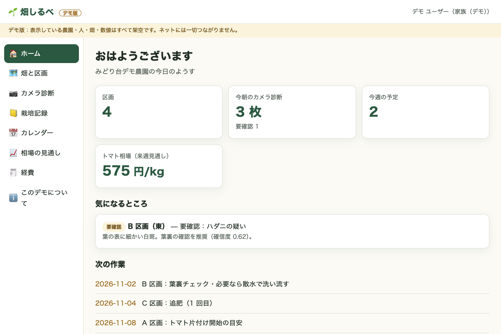
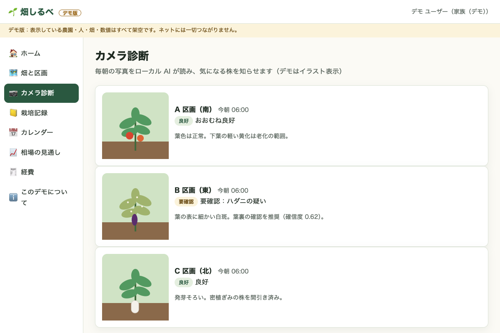
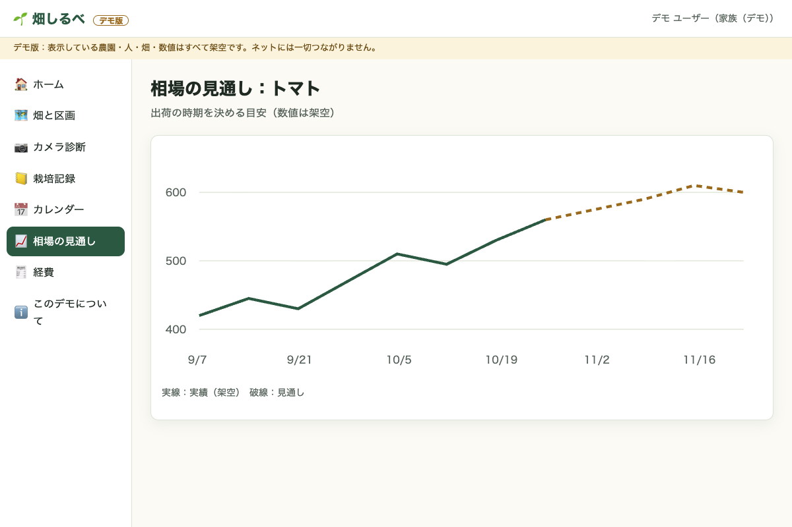
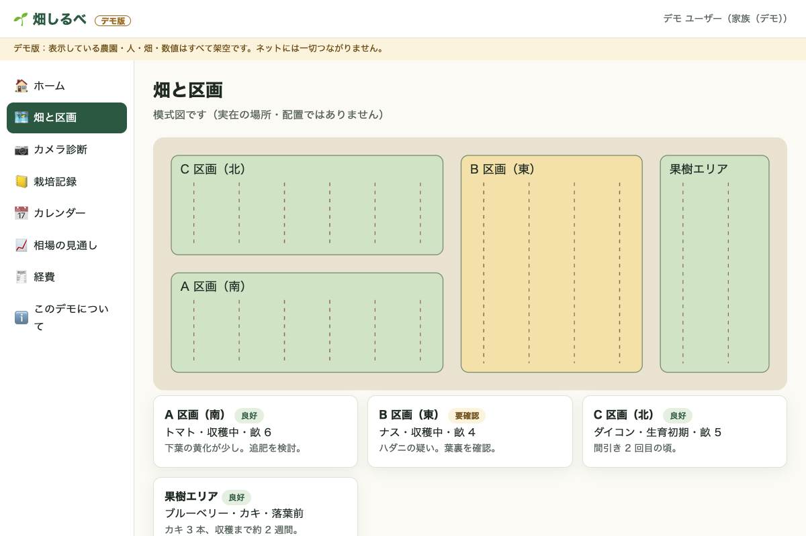
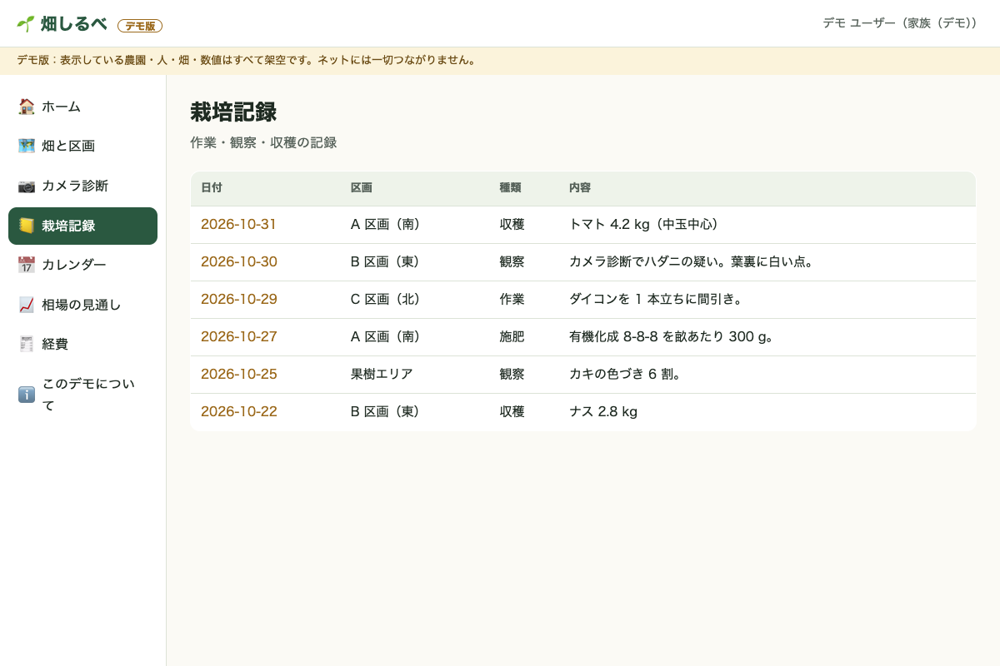

# 畑しるべ — デモ版

[English](README.md)

**畑しるべ**は、家庭菜園・小さな畑の観察を家族で共有するアプリです。毎朝のカメラ写真をローカル AI が読んで気になる株を知らせ、区画の地図、栽培記録、作業カレンダー、出荷時期を決めるための相場の見通し、レシートからの経費記帳までをまとめて見られます。

このリポジトリは、見た目と流れを紹介するための**デモ版**です。Claude（Anthropic）と一緒に作りました。

- **データはすべて架空**です（農園・人・畑・数値）。実在の場所・住所・顔・写真は入っていません。植物はイラストです。
- **完全にオフライン**で動きます。同梱のファイルだけを読み、ネットへの通信はすべて止めています。テレメトリ・自動更新・アカウントはありません。
- 本物（非公開）は自宅のサーバーで動いていますが、このデモはそこにつながりません。

| ホーム | カメラ診断 | 相場の見通し |
|---|---|---|
|  |  |  |

| 畑と区画 | 栽培記録 |
|---|---|
|  |  |

## ダウンロード（ベータ・署名なし）

[Releases](../../releases) から OS に合うファイルを取り、`SHA256SUMS` と照らし合わせてください。

**ベータ版で、開発者登録の署名はしていません**。初回は OS が警告を出します。

- **Mac**（Apple シリコンは `mac-arm64`、Intel は `mac-x64`）：解凍してアプリを「アプリケーション」へ移し、**右クリック →「開く」→「開く」**。それでも止められたら「システム設定 → プライバシーとセキュリティ →『このまま開く』」。アプリ全体は ad-hoc 署名で封印してあります。
- **Windows**：解凍して `Hatake Shirube Demo.exe` を実行。SmartScreen が出たら **「詳細情報」→「実行」**。
- **Linux**：`chmod +x *.AppImage && ./hatake-shirube-demo-*.AppImage`（`.tar.gz` もあります）。

## ソースから動かす

```bash
npm ci
npm start                 # デモの画面が開く
npm run audit:pii         # push 前に個人情報・通信コードがないか確認
npx electron scripts/screenshots.js   # スクリーンショットを撮り直す
```

画面は `app/` の素の HTML/CSS/JS（ビルド不要）、`electron/main.js` がオフラインの外枠です。CI（`.github/workflows/build.yml`）が push ごとに Mac・Windows・Linux 版を作り、`v*` タグでは `SHA256SUMS` 付きの**下書き**リリースを作ります。

ライセンス：MIT
