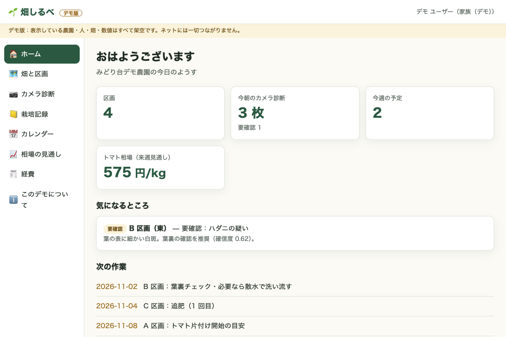
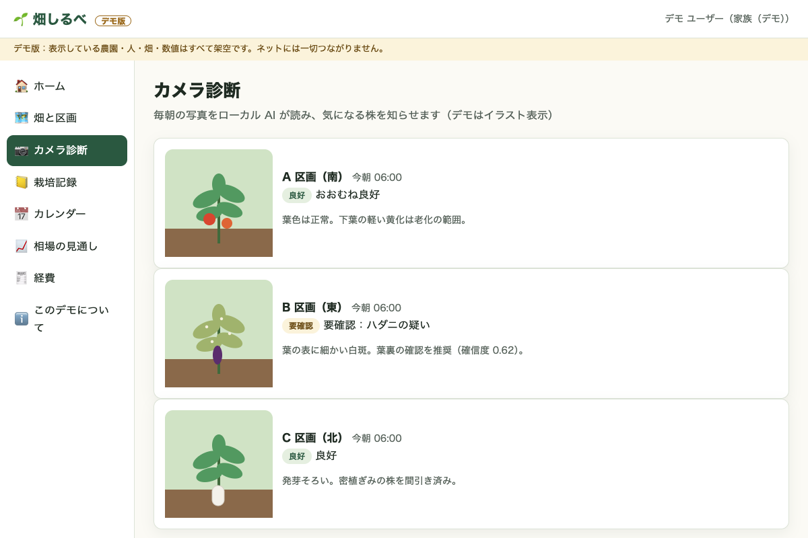
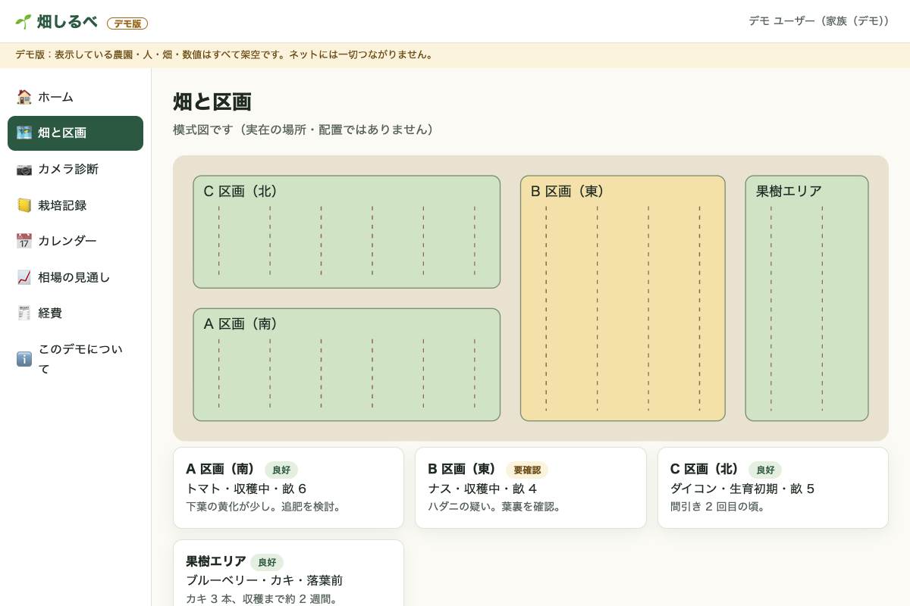
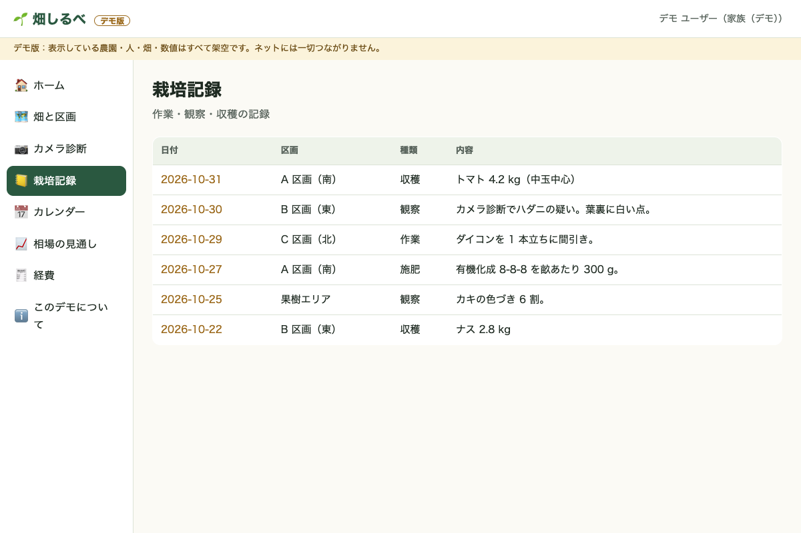

# Hatake Shirube — Demo

[日本語](README.ja.md)

**Hatake Shirube** ("field guide") is a home-garden / small-farm observation app a family shares: morning camera checks read by a local AI, a field map, a work log, a task calendar, a price outlook for deciding when to ship, and receipt-based expenses.

This repository is a **demo build** for showing what the app looks like. It was built with Claude (Anthropic).

- **All data is fictional** — the farm, people, fields and numbers. No real place, address, face or photo is included; plants are drawings.
- **Fully offline** — the desktop app loads only bundled files and blocks every network request. No telemetry, no auto-update, no accounts.
- The real app (private) runs on a home server; this demo does not connect to it.

| Home | Camera check | Price outlook |
|---|---|---|
|  |  |  |

| Fields | Work log |
|---|---|
|  |  |

## Download (beta, unsigned)

Get the file for your OS from [Releases](../../releases) and check it against `SHA256SUMS`.

These are **beta builds and are not signed by a registered developer**, so your OS will warn you the first time:

- **macOS** (`mac-arm64` for Apple silicon, `mac-x64` for Intel): unzip, move the app to Applications, then **right-click → Open → Open**. If macOS still blocks it: System Settings → Privacy & Security → "Open Anyway". The app is ad-hoc signed as a whole bundle.
- **Windows**: unzip and run `Hatake Shirube Demo.exe`. On the SmartScreen warning choose **More info → Run anyway**.
- **Linux**: `chmod +x *.AppImage && ./hatake-shirube-demo-*.AppImage` (or use the `.tar.gz`).

## Run from source

```bash
npm ci
npm start                 # opens the demo window
npm run audit:pii         # checks for private info / network calls before pushing
npx electron scripts/screenshots.js   # regenerate docs/screenshots
```

The UI is plain HTML/CSS/JS in `app/` (no build step); `electron/main.js` is the offline shell. CI (`.github/workflows/build.yml`) builds macOS, Windows and Linux on every push, and on a `v*` tag creates a **draft** release with `SHA256SUMS`.

License: MIT
